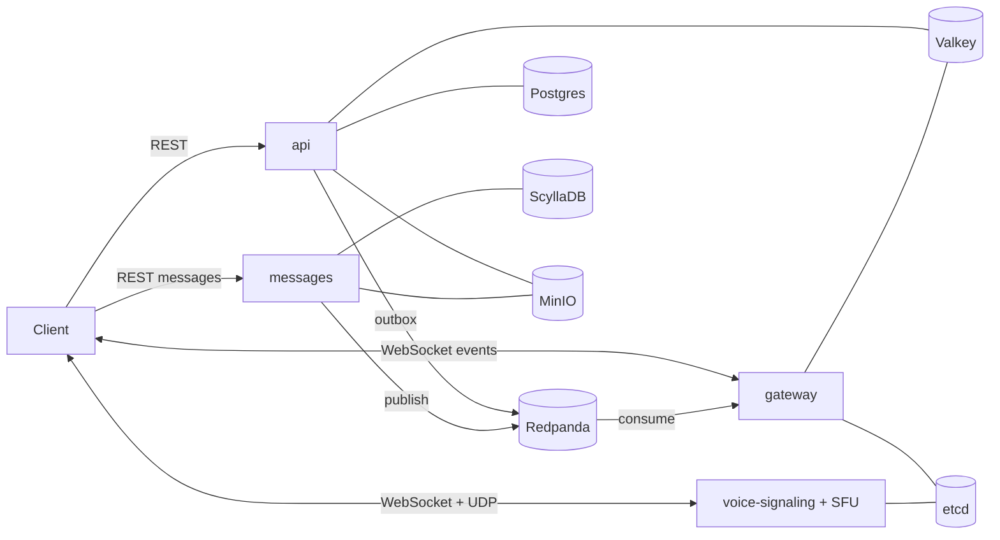

# How Voics works

Summary: the end-to-end picture, from a message typed in the client to the data stores, the event bus and the voice path.

Voics is a Discord-equivalent platform without payments. It is split into small services, one repository each ([ADR-0002](../adr/0002-repo-per-service.md)), and runs on one microk8s cluster on the home server `gen-serv` ([ADR-0008](../adr/0008-microk8s-reuse.md)). This page explains how the pieces fit together. Details live in the [design specification](../specs/2026-10-16-voics-platform-design.md), the [C4 diagrams](../c4/README.md) and the [protocol references](../protocols/README.md).

## The parts

| Part | Repo | Tech | Job |
|---|---|---|---|
| Desktop client | `client` | Electron, React, Rust crypto module | What users run. Talks to api, messages, gateway and voice. |
| api | `api` | Rust, axum, Postgres | Accounts, guilds, channels, roles, invites, bots, commands. Owns the relational data. |
| messages | `messages` | Rust, axum, ScyllaDB | Message history, reactions, pins, read states, attachments. |
| gateway | `gateway` | Elixir, Phoenix | The realtime WebSocket: sessions, presence, fan-out of events, voice allocation. |
| voice-signaling and SFU | `voice` | Elixir and Rust (str0m) | Voice and video rooms: signaling over WebSocket, media over UDP. |
| admin | `admin` | Rust BFF, React SPA | Operator portal behind Cloudflare Access. |
| contracts | `contracts` | OpenAPI, JSON Schema | The single source of truth for every wire format. |
| gitops | `gitops` | Flux, Terraform, bash | Everything that runs the platform. |

## Request path and event path

A client uses two channels. REST (`/api/v1`) is for actions and history. The gateway WebSocket is for everything that happens live.

1. The client sends a message with `POST /channels/{id}/messages`. The ingress routes it to **messages**, which asks **api** whether the user may write there (permission check, cached for 5 seconds).
2. messages writes the row to **ScyllaDB** and publishes an event to the **`discordy.message.v1`** topic on **Redpanda**.
3. The **gateway** consumes the topic and fans the event out to every session allowed to see the channel (membership, intents and `VIEW_CHANNEL`). The client receives a `MESSAGE_CREATE` dispatch.

Changes owned by api (guilds, roles, members) use a **transactional outbox**: the row and the event are written in one Postgres transaction and a relay publishes them to Redpanda, so an event is never lost or sent for a change that rolled back.

## Where each kind of data lives

| Store | Holds | Written by |
|---|---|---|
| Postgres 17 (CloudNativePG) | Users, devices, guilds, channels, roles, members, invites, bots, audit log; a second database `discordy_admin` for admin rollups | api, admin-bff |
| ScyllaDB | Messages in 10-day buckets, reactions, pins, read states ([ADR-0010](../adr/0010-scylladb-bucketing.md)) | messages |
| Valkey | Rate-limit buckets, gateway sessions and resume buffers, presence, voice allocation, E2EE inbox streams | api, gateway |
| MinIO | Avatars, emoji, attachments (private bucket, signed downloads), desktop installers, the website | api, messages, CI |
| Redpanda | The event bus, one topic per domain (`discordy.guild.v1`, `discordy.message.v1`, `discordy.user.v1`, ...) | api, messages, gateway, voice |
| etcd | Which voice nodes are alive (10-second leases) and gateway cluster membership | voice-signaling, gateway |
| OpenBao | Every runtime secret, `kv/discordy/*` | secrets-sync, read by External Secrets Operator |

See the [service catalog](../services/catalog.md) for ports, env vars and SLOs of each.

## Delivery modes

Every channel has a delivery mode ([ADR-0003](../adr/0003-delivery-modes.md), [guarantees](../protocols/delivery-modes.md)):

| Mode | Path | Server sees |
|---|---|---|
| Standard | client, messages, ScyllaDB, event bus, gateway | plaintext, stored |
| Ephemeral (MLS) | client encrypts with MLS, ciphertext relayed through per-device inbox streams in Valkey (7-day TTL) | ciphertext only |
| P2P | peers connect directly (WebRTC data channel); the gateway only relays signaling, TURN helps when NAT blocks | signaling only |

The messages service accepts only `standard` channels and answers `409` with code `50160` for the others.

## Voice path

1. The client asks the gateway to join a voice channel. The gateway picks the **non-draining node with the fewest users in the guild's region** (from etcd), stores the choice in Valkey and answers with `VOICE_SERVER_UPDATE` and a short-lived token. All voice channels of a guild share one node.
2. The client opens the voice WebSocket (`discordy-rtc-<region>.voics.nl`, port 4100) on **voice-signaling**, which supervises the local **SFU**.
3. Media flows over UDP port 50000 to the SFU (ICE-lite, DTLS-SRTP), which forwards audio and simulcast video to the other participants. If the SFU restarts, signaling replays the sessions.
4. coturn (UDP/TCP 3478) is used for P2P calls only; the gateway hands out short-lived TURN credentials in `READY`.

Regions are explained in [Voice regions](07-voice-regions.md).

## Authentication

- Users log in at api and receive an **EdDSA (Ed25519) JWT**; the public key is configured on every service so each one validates tokens locally. A second factor (TOTP) is supported, WebAuthn is proposed ([ADR-0015](../adr/0015-webauthn-second-factor.md)).
- Bots use bot tokens, introspected through api (cached 60 seconds in messages and gateway).
- Service to service calls use `X-Internal-Token` on `/internal/v1/*`, reachable only inside the cluster.
- Operator tools sit behind an IP lock and Cloudflare Access ([Ops and access](04-ops-and-access.md)).

## Edge, CDN and signed URLs

Everything public reaches the cluster through a **Cloudflare Tunnel** to ingress-nginx; no inbound port is open ([ADR-0005](../adr/0005-cloudflare-tunnel.md)). Hostnames are one level under `voics.nl` (`discordy-api`, `discordy-gateway`, `discordy-cdn`, ...). Attachments are served from the CDN host with **signed, expiring URLs** verified by the messages service, which streams the object from the private MinIO bucket ([ADR-0017](../adr/0017-signed-attachment-download-urls.md)).

## Observability

Every backend service exposes `/healthz`, `/readyz` and `/metrics`, logs JSON and can export OpenTelemetry. VictoriaMetrics scrapes each service under its own job name, Grafana draws the dashboards, and the admin portal shows platform health from the same data. See [Ops and access](04-ops-and-access.md).

## Where to go next

- Per application: [Applications](02-apps-overview.md).
- Rules of the house: [How we work](03-how-we-work.md).
- Words you do not know: [Glossary and FAQ](10-glossary-and-faq.md).
