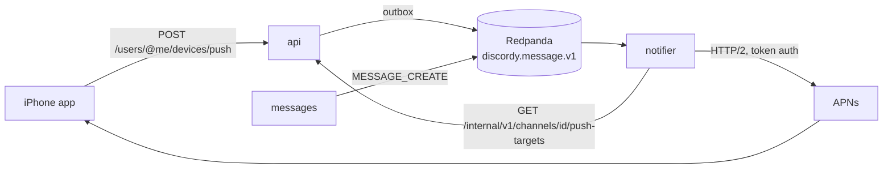

# Push notifications

How a message becomes a notification on an iPhone, what the owner must provide before it works, how to turn it on, and what to check when it does not. Plan: [mobile app](../plans/2026-11-03-mobile-app.md) (Notifier, Back-pressure and Privacy rows). Decision record for the bounded queue: [ADR 0016](../adr/0016-push-backpressure.md).

## How it works



1. The app registers its APNs device token with the api, one per login session, together with the APNs environment it was issued for (`sandbox` or `production`) and two device preferences (message previews, only mentions). It registers again on every start. The api removes the token with its session (logout, remote revoke, logout everywhere, suspension), with its encrypted-message device, and when it was not refreshed for `DEVICE_MAX_IDLE_DAYS`.
2. The **notifier** (`messages` repo, image `ghcr.io/discordy-voics/messages-notifier`, namespace `voics-apps`, port 8085) reads `MESSAGE_CREATE` from `discordy.message.v1`. For each message it asks the api for the members who can view the channel, are not the author and hold a token on a live session.
3. It applies the clients' rules to each of them: no push while the user has a live gateway session (the app shows its own banner), then mute (guild, channel or category), the effective level (channel, category, guild, server default), direct messages, direct mentions, role mentions, `@everyone` (unless suppressed), `@here` (never reaches an offline member), `@silent`, and the device's own only-mentions preference.
4. It sends through APNs over HTTP/2 with a provider token signed by the `.p8` key. Each token goes to the sandbox or the production host it was issued for; on `BadDeviceToken` the other host gets one try, and a host that works is remembered. A token APNs rejects for good (`410`, `BadDeviceToken` on both hosts, `DeviceTokenNotForTopic`) is deleted through the api.

**Privacy.** Only a channel whose delivery mode is exactly `standard` may put message text, the author or the channel and server names into a push. Every other mode, and any mode the notifier does not know, gets the title "New message" and nothing else. A device that turned previews off gets "New message" as the body in standard chats too. Encrypted (Ephemeral) and peer-to-peer messages do not travel on the message topic at all (the gateway relays them), so today no push is produced for them; the rule is in place for the day one is.

**Back-pressure (ADR 0016).** Pushes wait in a bounded queue (`PUSH_QUEUE_CAPACITY`, default 10000). At most `PUSH_MAX_IN_FLIGHT` (default 100) provider requests run at once. When the queue is full new pushes are dropped and counted, never blocking the event consumer. Failed sends are retried with backoff (`PUSH_MAX_ATTEMPTS`, default 3) and then recorded as failed. Events older than `PUSH_MAX_EVENT_AGE_SECS` (default 120) are not pushed.

**One replica only.** The notifier has no consumer group and stores no offset: it starts at the end of the topic. A second pod would push every message twice, so the Deployment uses the `Recreate` strategy and one replica. A restart loses at most the messages sent while it was down, which is intended: a push for an old message only annoys.

## What the owner must provide

The deployment ships at **0 replicas** and the `notifier-secrets` ExternalSecret cannot sync, so nothing crash-loops and no alert fires. Until the three values below exist in OpenBao, the iPhone app registers tokens but nobody sends.

| What | Where it comes from | Where it goes |
|---|---|---|
| The APNs auth key, a `.p8` file | Apple Developer account, Certificates, Identifiers & Profiles, Keys, **+**, tick *Apple Push Notifications service (APNs)*, Register, **Download** (Apple shows it once) | GitHub secret `NOTIFIER_APNS_KEY` (the whole file, BEGIN and END lines included) |
| Its Key ID (10 characters, shown beside the key) | Same page | GitHub secret `NOTIFIER_APNS_KEY_ID` |
| The Team ID (10 characters) | Apple Developer account, Membership details | GitHub secret `NOTIFIER_APNS_TEAM_ID` |

One key serves the sandbox and production hosts. The bundle id (`nl.voics.app`, the APNs topic) is not a secret and is already in the ConfigMap. The app's App ID must also have the **Push Notifications** capability: the first iOS build after this change adds the `aps-environment` entitlement, and EAS syncs the capability and regenerates the provisioning profile when you build interactively (owner steps, [docs#10](https://github.com/discordy-voics/docs/issues/10)). Nothing in the repositories can create these values.

## Turning push on

Do this once the three values are in hand. Production first, dev the same way with the dev paths.

1. **Store the values** in the gitops repository's `production` environment. Pipe the key from the file, never as an argument:

   ```bash
   gh secret set NOTIFIER_APNS_KEY --repo discordy-voics/gitops --env production < AuthKey_XXXXXXXXXX.p8
   gh secret set NOTIFIER_APNS_KEY_ID --repo discordy-voics/gitops --env production --body XXXXXXXXXX
   gh secret set NOTIFIER_APNS_TEAM_ID --repo discordy-voics/gitops --env production --body YYYYYYYYYY
   ```

2. **Sync to OpenBao**: `gh workflow run secrets-sync.yml --repo discordy-voics/gitops -f paths=discordy/notifier`, then `gh run watch`. Until the three GitHub secrets exist, every `secrets-sync` run reports `skip kv/discordy/notifier: missing GitHub secret(s)` for this path and ends red, as it does for any unprovisioned path (the other paths are still written). For dev write the same three values to `kv/discordy-dev/notifier` (`25-secrets.sh` skips this path on purpose).
3. **Check the secret reached the cluster**: `kubectl -n voics-apps get externalsecret notifier-secrets` shows `SecretSynced`, and `kubectl -n voics-apps get secret notifier-secrets` exists. Force a refresh with `kubectl -n voics-apps annotate externalsecret notifier-secrets force-sync="$(date +%s)" --overwrite`.
4. **Scale it up**: in `gitops/apps/notifier/production/kustomization.yaml` change the `replicas` count from `0` to `1` (dev: `apps/notifier/dev/kustomization.yaml`), merge through the normal flow ([release](release.md)). Flux reconciles within the `apps` interval.
5. **Verify**: `kubectl -n voics-apps rollout status deploy/notifier`; `kubectl -n voics-apps logs deploy/notifier` shows `notifier listening` and `consumer started` once per partition; `curl` of `/readyz` through a port-forward answers `ok`. A wrong key makes the pod exit at startup with `APNs key is not a valid .p8`.
6. **Smoke test with a real phone** (see below). The metric `notifier_pushes_total{outcome="sent"}` must move.

Turning it off again is the same one-line change back to `0`.

## Smoke test

Needs an iPhone with a development or preview build of the app, signed in, notifications allowed.

1. Open a chat once (the app then holds a registered token). Check in pgweb: `select user_id, platform, environment, previews, only_mentions, updated_at from push_tokens order by updated_at desc limit 5;`.
2. Close the app (swipe it away; a live gateway session suppresses the push).
3. From another account send a message to the phone's account. A notification with the sender and text arrives within a few seconds. Tapping it opens the chat at that message.
4. In the app set the chat to mentions only and send again: no push; mention the account: a push.
5. Switch the app's *Show message previews* off: the body becomes "New message".
6. Open the app while a message arrives: no system banner (the in-app banner shows).

## Sandbox and production tokens

A build signed with a development provisioning profile (a local `expo run:ios`, or an EAS `development` build installed through Xcode) gets sandbox tokens. TestFlight, App Store and ad-hoc builds get production tokens, and EAS `internal` distribution is ad-hoc. The app reports the environment from its build profile and the notifier falls back to the other host once when APNs answers `BadDeviceToken`, so a wrong guess costs one extra request and not a lost push (`notifier_apns_host_corrections_total` counts them). `APNS_ENVIRONMENT=sandbox` or `production` in `notifier-config` forces one host for every token and turns the fallback off.

## Metrics and alerts

Scrape job `notifier` on port 8085 (not listed in the admin health page while it runs at 0 replicas).

| Metric | Meaning |
|---|---|
| `notifier_events_total{result}` | `processed`, `duplicate`, `stale`, `unparsable`, `not_pushable`, `directory_error` |
| `notifier_decisions_total{verdict}` | `notify`, `online`, `muted`, `level_nothing`, `not_mentioned`, `device_only_mentions` |
| `notifier_pushes_total{provider,outcome}` | `sent`, `failed`, `invalid_token` (token removed), `dropped` (queue full), `unsupported` (FCM tokens, not sent yet) |
| `notifier_push_retries_total`, `notifier_push_duration_seconds` | retries and provider latency |
| `notifier_queue_depth` | jobs waiting for a free slot |
| `notifier_apns_errors_total{status,reason}` | APNs error answers |
| `notifier_apns_host_corrections_total` | tokens found on the other APNs host |

Alerts (`push` group, [alerting](alerting.md)): `PushSendFailures`, `PushDropped`, `ApnsCredentialsRejected`; `ServiceDown` and `PodCrashLooping` cover the pod itself.

## When something is wrong

| Symptom | Check |
|---|---|
| No push at all | `push_tokens` has a row for the user? The app asks for permission the first time a chat is open, and a refusal is final (Settings, Notifications, Open Settings). Deployment at 0 replicas? `notifier_events_total{result="processed"}` moving? |
| Push for some people only | `notifier_decisions_total`: `online` (a live session suppresses it), `muted`, `level_nothing`, `not_mentioned`, `device_only_mentions` explain skips |
| `ApnsCredentialsRejected` | Key, Key ID or Team ID is wrong or revoked: [secret rotation, APNs key](secret-rotation.md#apns-key) |
| `notifier_pushes_total{outcome="dropped"}` rising | Burst or slow APNs: look at `notifier_push_duration_seconds` and `notifier_queue_depth`; raise `PUSH_QUEUE_CAPACITY` or `PUSH_MAX_IN_FLIGHT` in `notifier-config` only after checking memory (limit 96Mi) |
| `BadDeviceToken` for every token | The App ID or topic does not match (`APNS_TOPIC`), or the build has no push entitlement |
| Every message pushes twice | A second notifier pod is running: scale to one |
| `directory_error` events | The api is unreachable or answering errors on `push-targets` |

## Not covered yet

- FCM (Android): tokens can be registered but are counted `unsupported` and not sent.
- VoIP pushes for calls ([separate ticket](https://github.com/discordy-voics/messages/issues/56)): the APNs sender already supports the `.voip` topic and `OutboundPush::Voip`; nothing produces them.
- A badge count in the push payload: the app sets its own badge from the unread mentions while it runs.
- Pushes for Ephemeral and peer-to-peer messages: they bypass the message topic, so there is nothing for the notifier to read.
